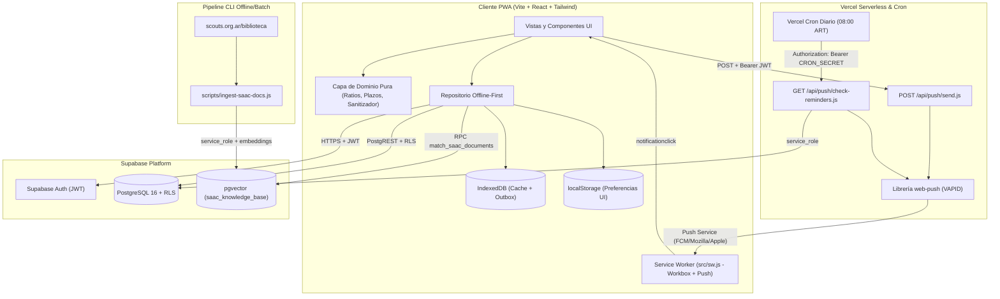
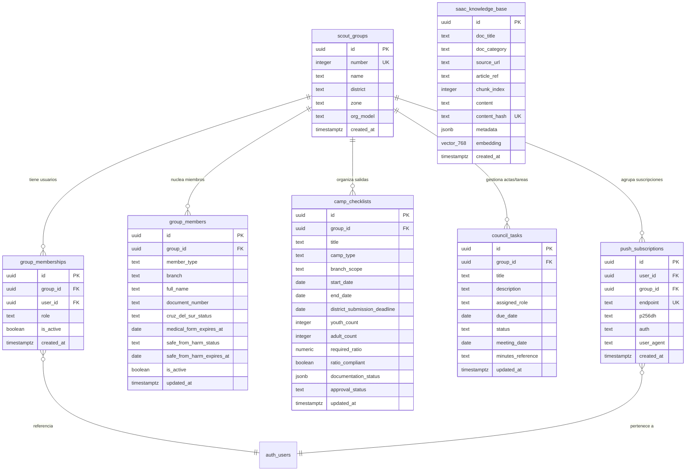

# Arquitectura Técnica: ConsejoScout PWA

**Versión:** 1.0.0  
**Workspace:** `/Users/juanjopascuzzi/apps/MiGrupoScout`  
**Dominio:** Asistente operativo, administrativo y normativo para Jefaturas de Grupo y Consejos de Grupo de Scouts de Argentina Asociación Civil (SAAC).  

---

## 1. Visión General y Principios Arquitectónicos

ConsejoScout es una Aplicación Web Progresiva (PWA) multi-tenant diseñada bajo un enfoque **Offline-First**, con aislamiento estricto de datos por Grupo Scout (`group_id`), cumplimiento de privacidad para datos de menores de edad y soporte normativo asistido por búsqueda vectorial (`pgvector`) sobre documentos oficiales de SAAC.

### Principios de Diseño

1. **Separación de Responsabilidades (SoC):** La lógica de negocio SAAC (ratios adulto/beneficiario, cálculo de vencimientos, plazos distritales y sanitización de notificaciones) se implementa exclusivamente como **funciones puras** en `src/domain/`, desacopladas de React y de Supabase.
2. **Offline-First Real:** Los Jefes de Grupo suelen operar en campos scouts o zonas sin conectividad. Toda lectura crítica se cachea en `IndexedDB` y toda mutación en campo pasa por una cola local (`outbox_queue`) con sincronización idempotente al recuperar red.
3. **Privacidad por Diseño (Zero-PII en Push y Cero Acceso Anónimo):** Las nóminas de beneficiarios y fichas médicas jamás son accesibles sin sesión autenticada y pertenencia verificada al grupo. Las notificaciones Web Push nunca transportan nombres completos de menores, DNI ni diagnósticos médicos.
4. **Custodia de Secretos en Servidor:** Las claves privadas VAPID y la `SUPABASE_SERVICE_ROLE_KEY` residen únicamente en funciones Serverless de Vercel (`/api/**`), nunca en el bundle de Vite.

---

## 2. Diagrama de Arquitectura del Sistema



---

## 3. Stack Tecnológico

| Capa | Tecnología | Propósito |
| :--- | :--- | :--- |
| Frontend Core | React 18+ / Vite / Tailwind CSS | SPA responsiva Mobile-First |
| PWA & Service Worker | `vite-plugin-pwa` (`injectManifest`) + Workbox | Precache de assets, fallback offline, eventos `push` y `notificationclick` |
| Persistencia Local | `idb` (IndexedDB) + `localStorage` | Cache de entidades por `group_id` y cola de mutaciones offline |
| BaaS & Auth | `@supabase/supabase-js` | Autenticación JWT, PostgreSQL, Row Level Security (RLS), RPC vectorial |
| Base de Datos | PostgreSQL 16 + `pgvector` | Persistencia relacional multi-tenant y embeddings de normativa SAAC |
| Backend Serverless | Vercel Functions (Node.js 20 ESM) | Envío Web Push (`web-push`) y Cron de recordatorios (`CRON_SECRET`) |
| Ingesta RAG | Node.js + `pdf-parse` + Embeddings API | Chunking e indexación de normativa desde `scouts.org.ar/biblioteca` |

---

## 4. Estructura de Archivos del Proyecto

```text
/Users/juanjopascuzzi/apps/MiGrupoScout/
├── api/
│   ├── _lib/
│   │   ├── supabaseAdmin.js       # Cliente Supabase con SUPABASE_SERVICE_ROLE_KEY
│   │   ├── pushDispatcher.js      # Wrapper web-push + manejo de 404/410 Gone
│   │   └── payloadSanitizer.js    # Validación y remoción de PII/PHI en notificaciones
│   └── push/
│       ├── send.js                # Endpoint autenticado para disparo manual/de consejo
│       └── check-reminders.js     # Cron diario protegido por CRON_SECRET
├── database/
│   └── schema.sql                 # DDL completo, pgvector, índices, triggers y RLS
├── docs/
│   └── ARCHITECTURE.md            # Este documento de arquitectura
├── public/
│   ├── offline.html               # Página fallback sin conexión
│   └── icons/                     # Iconos PWA (192x192, 512x512, maskable, badge)
├── scripts/
│   └── ingest-saac-docs.js        # CLI de ingesta desde scouts.org.ar/biblioteca
├── src/
│   ├── config/
│   │   ├── env.js                 # Validación de variables VITE_*
│   │   └── saacLinks.js           # Enlaces oficiales SAAC centralizados
│   ├── domain/
│   │   ├── saacRules.js           # Funciones puras: ratios, plazos distritales, alertas
│   │   └── validators.js          # Validación de formularios y estados normativos
│   ├── services/
│   │   ├── supabaseClient.js      # Singleton @supabase/supabase-js
│   │   ├── offlineDb.js           # Esquema IndexedDB (stores + outbox_queue)
│   │   ├── syncEngine.js          # Reconciliación online/offline y backoff
│   │   ├── pushClient.js          # Registro PushManager + suscripción VAPID
│   │   └── knowledgeService.js    # Consulta semántica vía RPC match_saac_documents
│   ├── hooks/
│   │   ├── useOfflineSync.js      # Estado de red y cola pendiente
│   │   └── useGroupContext.js     # Sesión actual y rol en scout_groups
│   ├── components/
│   │   └── ...                    # Componentes UI desacoplados
│   ├── pages/
│   │   └── ...                    # Dashboard, Nómina, Campamentos, Consejo, Biblioteca
│   ├── sw.js                      # Service Worker personalizado (injectManifest)
│   ├── App.jsx
│   └── main.jsx
├── .env.example
├── index.html
├── package.json
├── tailwind.config.js
├── vercel.json                    # Configuración de Vercel Cron y rewrites SPA
└── vite.config.js                 # Configuración Vite + VitePWA (injectManifest)
```

---

## 5. Diseño de Base de Datos (Supabase + `pgvector`)

Ubicación del DDL: `/database/schema.sql`.

### 5.1 Diagrama Entidad-Relación



### 5.2 Especificación de Tablas y Columnas

1. **`scout_groups`**:
   - `id uuid PRIMARY KEY DEFAULT gen_random_uuid()`
   - `number integer NOT NULL UNIQUE` (Número oficial de Grupo en SAAC)
   - `name text NOT NULL`
   - `district text NOT NULL`
   - `zone text NOT NULL`
   - `org_model text NOT NULL DEFAULT 'tradicional'` (`'tradicional' | 'nucleo' | 'comunitario' | 'escolar'`)
   - `created_at timestamptz NOT NULL DEFAULT now()`
   - `updated_at timestamptz NOT NULL DEFAULT now()`

2. **`group_memberships`** (Tabla puente obligatoria para RLS multi-tenant sin depender de claims mutables):
   - `id uuid PRIMARY KEY DEFAULT gen_random_uuid()`
   - `group_id uuid NOT NULL REFERENCES scout_groups(id) ON DELETE CASCADE`
   - `user_id uuid NOT NULL REFERENCES auth.users(id) ON DELETE CASCADE`
   - `role text NOT NULL CHECK (role IN ('jefe_grupo', 'subjefe_grupo', 'jefe_rama', 'educador', 'secretario', 'tesorero', 'consejero'))`
   - `is_active boolean NOT NULL DEFAULT true`
   - `created_at timestamptz NOT NULL DEFAULT now()`
   - `UNIQUE (group_id, user_id)`

3. **`group_members`** (Nómina operativa de beneficiarios y educadores):
   - `id uuid PRIMARY KEY DEFAULT gen_random_uuid()`
   - `group_id uuid NOT NULL REFERENCES scout_groups(id) ON DELETE CASCADE`
   - `member_type text NOT NULL CHECK (member_type IN ('beneficiario', 'educador', 'colaborador'))`
   - `branch text NOT NULL CHECK (branch IN ('manada', 'unidad', 'caminantes', 'rovers', 'jefatura'))`
   - `full_name text NOT NULL`
   - `document_number text` (Opcional / cifrado o enmascarado en UI; nunca enviado en push)
   - `cruz_del_sur_status text NOT NULL DEFAULT 'pendiente' CHECK (cruz_del_sur_status IN ('afiliado', 'pendiente', 'vencido', 'baja'))`
   - `medical_form_expires_at date`
   - `safe_from_harm_status text NOT NULL DEFAULT 'no_aplica' CHECK (safe_from_harm_status IN ('vigente', 'pendiente', 'vencido', 'no_aplica'))`
   - `safe_from_harm_expires_at date`
   - `is_active boolean NOT NULL DEFAULT true`
   - `created_at timestamptz NOT NULL DEFAULT now()`
   - `updated_at timestamptz NOT NULL DEFAULT now()`
   - **Índices:** `(group_id, branch, is_active)`, `(group_id, medical_form_expires_at)`

4. **`camp_checklists`** (Salidas y campamentos):
   - `id uuid PRIMARY KEY DEFAULT gen_random_uuid()`
   - `group_id uuid NOT NULL REFERENCES scout_groups(id) ON DELETE CASCADE`
   - `title text NOT NULL`
   - `camp_type text NOT NULL CHECK (camp_type IN ('salida_dia', 'acantonamiento', 'campamento_corto', 'campamento_largo', 'fuera_distrito'))`
   - `branch_scope text NOT NULL CHECK (branch_scope IN ('manada', 'unidad', 'caminantes', 'rovers', 'grupal'))`
   - `location text`
   - `start_date date NOT NULL`
   - `end_date date NOT NULL`
   - `district_submission_deadline date NOT NULL`
   - `youth_count integer NOT NULL DEFAULT 0 CHECK (youth_count >= 0)`
   - `adult_count integer NOT NULL DEFAULT 0 CHECK (adult_count >= 0)`
   - `required_adults integer NOT NULL DEFAULT 2` (Calculado por regla SAAC y validado por trigger/dominio)
   - `ratio_compliant boolean NOT NULL DEFAULT false`
   - `documentation_status jsonb NOT NULL DEFAULT '{"carpeta_medica": false, "autorizaciones": false, "seguro_cruz_del_sur": false, "proyecto_educativo": false, "a_salvo_del_peligro": false}'::jsonb`
   - `approval_status text NOT NULL DEFAULT 'borrador' CHECK (approval_status IN ('borrador', 'en_revision_consejo', 'presentada_distrito', 'aprobada', 'observada'))`
   - `created_by uuid REFERENCES auth.users(id)`
   - `created_at timestamptz NOT NULL DEFAULT now()`
   - `updated_at timestamptz NOT NULL DEFAULT now()`
   - **Índices:** `(group_id, start_date)`, `(group_id, district_submission_deadline)`

5. **`council_tasks`** (Tareas y actas del Consejo de Grupo):
   - `id uuid PRIMARY KEY DEFAULT gen_random_uuid()`
   - `group_id uuid NOT NULL REFERENCES scout_groups(id) ON DELETE CASCADE`
   - `title text NOT NULL`
   - `description text`
   - `assigned_role text NOT NULL CHECK (assigned_role IN ('jefe_grupo', 'subjefe_grupo', 'jefe_rama', 'educador', 'secretario', 'tesorero', 'consejo_pleno'))`
   - `due_date date`
   - `status text NOT NULL DEFAULT 'pendiente' CHECK (status IN ('pendiente', 'en_progreso', 'completada', 'vencida'))`
   - `meeting_date date`
   - `minutes_reference text` (Número de Acta / Orden del día)
   - `created_by uuid REFERENCES auth.users(id)`
   - `created_at timestamptz NOT NULL DEFAULT now()`
   - `updated_at timestamptz NOT NULL DEFAULT now()`
   - **Índices:** `(group_id, status, due_date)`

6. **`push_subscriptions`**:
   - `id uuid PRIMARY KEY DEFAULT gen_random_uuid()`
   - `user_id uuid NOT NULL REFERENCES auth.users(id) ON DELETE CASCADE`
   - `group_id uuid NOT NULL REFERENCES scout_groups(id) ON DELETE CASCADE`
   - `endpoint text NOT NULL UNIQUE`
   - `p256dh text NOT NULL`
   - `auth text NOT NULL`
   - `user_agent text`
   - `created_at timestamptz NOT NULL DEFAULT now()`
   - **Índices:** `(user_id)`, `(group_id)`

7. **`saac_knowledge_base`** (Conocimiento normativo con `pgvector`):
   - `id uuid PRIMARY KEY DEFAULT gen_random_uuid()`
   - `doc_title text NOT NULL` (Ej. `"Norma Operativa SAAC"`, `"Política A Salvo del Peligro"`)
   - `doc_category text NOT NULL CHECK (doc_category IN ('norma_operativa', 'reglamento', 'proteccion_infantil', 'acampe_seguridad', 'educativo', 'otro'))`
   - `source_url text NOT NULL`
   - `article_ref text` (Ej. `"Art. 42 - Salidas y Campamentos"`)
   - `chunk_index integer NOT NULL`
   - `content text NOT NULL`
   - `content_hash text NOT NULL UNIQUE` (SHA-256 para upsert idempotente)
   - `metadata jsonb NOT NULL DEFAULT '{}'::jsonb`
   - `embedding vector(768) NOT NULL` (Dimensiones alineadas a modelo `text-embedding-004` / configurable a `1536` si se utiliza `text-embedding-3-small`)
   - `created_at timestamptz NOT NULL DEFAULT now()`
   - **Índice Vectorial:** `CREATE INDEX idx_saac_kb_embedding_hnsw ON saac_knowledge_base USING hnsw (embedding vector_cosine_ops);`

### 5.3 Función RPC de Búsqueda Vectorial

```sql
CREATE OR REPLACE FUNCTION match_saac_documents(
  query_embedding vector(768),
  match_threshold float DEFAULT 0.65,
  match_count int DEFAULT 6,
  filter_category text DEFAULT NULL
)
RETURNS TABLE (
  id uuid,
  doc_title text,
  doc_category text,
  article_ref text,
  source_url text,
  content text,
  similarity float
)
LANGUAGE sql STABLE
AS $$
  SELECT
    kb.id,
    kb.doc_title,
    kb.doc_category,
    kb.article_ref,
    kb.source_url,
    kb.content,
    1 - (kb.embedding <=> query_embedding) AS similarity
  FROM saac_knowledge_base kb
  WHERE (filter_category IS NULL OR kb.doc_category = filter_category)
    AND 1 - (kb.embedding <=> query_embedding) >= match_threshold
  ORDER BY kb.embedding <=> query_embedding
  LIMIT match_count;
$$;
```

### 5.4 Políticas RLS Estrictas (Aislamiento Multi-Tenant)

Todas las tablas habilitan `ALTER TABLE ... ENABLE ROW LEVEL SECURITY;` y `FORCE ROW LEVEL SECURITY;`.  
**Cero políticas para el rol `anon`** en cualquier tabla que contenga datos de grupos, menores, actas o suscripciones.

Funciones helper `SECURITY DEFINER` (con `SET search_path = public`):

```sql
CREATE OR REPLACE FUNCTION is_group_member(target_group_id uuid)
RETURNS boolean
LANGUAGE sql STABLE SECURITY DEFINER SET search_path = public
AS $$
  SELECT EXISTS (
    SELECT 1 FROM group_memberships
    WHERE group_id = target_group_id
      AND user_id = auth.uid()
      AND is_active = true
  );
$$;

CREATE OR REPLACE FUNCTION has_group_role(target_group_id uuid, allowed_roles text[])
RETURNS boolean
LANGUAGE sql STABLE SECURITY DEFINER SET search_path = public
AS $$
  SELECT EXISTS (
    SELECT 1 FROM group_memberships
    WHERE group_id = target_group_id
      AND user_id = auth.uid()
      AND is_active = true
      AND role = ANY(allowed_roles)
  );
$$;
```

Matriz de políticas por tabla:

| Tabla | `SELECT` | `INSERT` / `UPDATE` | `DELETE` |
| :--- | :--- | :--- | :--- |
| `scout_groups` | `is_group_member(id)` | `has_group_role(id, ARRAY['jefe_grupo', 'subjefe_grupo'])` | Denegado vía API cliente (solo `service_role`) |
| `group_memberships` | `user_id = auth.uid() OR is_group_member(group_id)` | `has_group_role(group_id, ARRAY['jefe_grupo', 'subjefe_grupo'])` | `has_group_role(group_id, ARRAY['jefe_grupo'])` |
| `group_members` | `is_group_member(group_id)` | `has_group_role(group_id, ARRAY['jefe_grupo', 'subjefe_grupo', 'secretario', 'jefe_rama'])` | `has_group_role(group_id, ARRAY['jefe_grupo', 'subjefe_grupo'])` |
| `camp_checklists` | `is_group_member(group_id)` | `has_group_role(group_id, ARRAY['jefe_grupo', 'subjefe_grupo', 'jefe_rama', 'educador'])` | `has_group_role(group_id, ARRAY['jefe_grupo', 'subjefe_grupo'])` |
| `council_tasks` | `is_group_member(group_id)` | `is_group_member(group_id)` | `has_group_role(group_id, ARRAY['jefe_grupo', 'subjefe_grupo', 'secretario'])` |
| `push_subscriptions` | `user_id = auth.uid()` | `user_id = auth.uid() AND is_group_member(group_id)` | `user_id = auth.uid()` |
| `saac_knowledge_base` | Rol `authenticated` (`auth.uid() IS NOT NULL`) | Solo `service_role` | Solo `service_role` |

---

## 6. Arquitectura PWA, Service Worker y Estrategia Offline-First

### 6.1 Configuración `vite-plugin-pwa` (`injectManifest`)

En `vite.config.js`:
- `strategies: 'injectManifest'`
- `srcDir: 'src'`
- `filename: 'sw.js'`
- `registerType: 'prompt'` (muestra aviso limpio de "Nueva versión disponible" para evitar pérdida de formularios en curso en campo)
- `manifest`: `display: 'standalone'`, `orientation: 'portrait'`, `start_url: '/'`, `scope: '/'`, `theme_color` y `background_color` institucionales.

### 6.2 Service Worker (`src/sw.js`)

Responsabilidades explícitas:
1. **Workbox Precache:** `precacheAndRoute(self.__WB_MANIFEST)` para el shell de la app (`index.html`, JS, CSS, fuentes e iconos).
2. **Offline Fallback:** `NavigationRoute` con `NetworkFirst` (timeout 3 segundos) y fallback a `/offline.html` o `index.html` precacheado cuando no hay red.
3. **Exclusión de Cache HTTP para Datos Sensibles:** Las rutas de Supabase (`/rest/v1/*`, `/auth/v1/*`) y `/api/*` utilizan `NetworkOnly` en el Service Worker; la persistencia offline estructurada vive exclusivamente en `IndexedDB` bajo control de la sesión activa (para poder purgarse al cerrar sesión).
4. **Listener `push`:**
   - Parsea `event.data.json()`.
   - Valida estructura esperada (`title`, `body`, `tag`, `url`).
   - Invoca `self.registration.showNotification(title, { body, icon, badge, tag, renotify: false, data: { url } })`.
5. **Listener `notificationclick`:**
   - Cierra la notificación (`event.notification.close()`).
   - Busca una ventana abierta del mismo origen (`clients.matchAll({ type: 'window', includeUncontrolled: true })`), enfoca y navega a `event.notification.data.url` (ej. `/campamentos`, `/nomina?filter=expiring`, `/consejo`), o abre una nueva ventana con `clients.openWindow(url)`.

### 6.3 Fallback Offline (`IndexedDB` + `localStorage`)

- **`localStorage`:** Almacena únicamente estado no sensible de UI (`consejoscout:theme`, `consejoscout:active_group_id`, `consejoscout:last_sync_at`).
- **`IndexedDB` (`consejoscout_db_v1`):**
  - `kv_cache`: Snapshots por tabla y `group_id` (`group_members`, `camp_checklists`, `council_tasks`, `scout_groups`).
  - `outbox_queue`: Cola FIFO de mutaciones realizadas sin conectividad:
    - `{ localId, table, operation: 'INSERT' | 'UPDATE' | 'DELETE', recordId, payload, updatedAt, retries, status: 'pending' | 'conflict' }`.
  - **Sincronización (`syncEngine.js`):**
    - Se dispara al evento `window.addEventListener('online')` y al enfocar la app.
    - Procesa `outbox_queue` secuencialmente contra Supabase; si el servidor responde `409`/conflicto de timestamp, marca estado `conflict` para resolución manual por el Jefe de Grupo.
  - **Limpieza de Seguridad al Logout:** Al ejecutar `supabase.auth.signOut()`, se vacía inmediatamente `IndexedDB` (`kv_cache` y `outbox_queue` tras confirmación o advertencia si hay pendientes) para evitar exposición de nóminas de menores en dispositivos compartidos.

---

## 7. Contratos de Endpoints Serverless en Vercel

### 7.1 `POST /api/push/send.js`

Envía notificaciones Web Push a usuarios de un grupo scout. Nunca acepta texto arbitrario con datos de menores sin pasar por sanitización.

- **Autenticación y Autorización:**
  - Cabecera obligatoria: `Authorization: Bearer <supabase_access_token>`.
  - El servidor valida el JWT mediante `supabaseAdmin.auth.getUser(token)`.
  - Verifica en `group_memberships` que el usuario solicitante esté activo en `group_id` y posea rol en `['jefe_grupo', 'subjefe_grupo', 'secretario', 'jefe_rama']`.

- **Request Body (`application/json`):**
```json
{
  "groupId": "uuid",
  "targetUserIds": ["uuid"],
  "eventType": "CAMP_DEADLINE" | "MEDICAL_EXPIRY" | "COUNCIL_TASK" | "GENERAL_NOTICE",
  "title": "Recordatorio de Consejo de Grupo",
  "body": "Hay documentación de campamento pendiente de revisión.",
  "url": "/campamentos"
}
```
  - Si `targetUserIds` se omite o está vacío, se envía a todos los miembros con suscripción activa dentro de `groupId`.
  - **Regla de Sanitización (`payloadSanitizer.js`):** Se restringen longitudes (`title <= 64`, `body <= 160`), se valida `url` como ruta relativa permitida (`^\/[a-zA-Z0-9\-\/\?=&]*$`), y se rechaza/enmascara cualquier patrón de DNI, teléfono o texto que coincida con nombres propios de la nómina o términos médicos sensibles.

- **Respuestas HTTP:**
  - `200 OK`:
    ```json
    {
      "success": true,
      "data": { "sent": 4, "failed": 0, "prunedExpired": 1 }
    }
    ```
  - `400 Bad Request`: `{ "success": false, "error": "Payload inválido o ruta de destino no permitida." }`
  - `401 Unauthorized`: `{ "success": false, "error": "Token de sesión ausente o inválido." }`
  - `403 Forbidden`: `{ "success": false, "error": "El usuario no posee permisos de conducción en el grupo indicado." }`
  - `405 Method Not Allowed`: `{ "success": false, "error": "Método no permitido." }`
  - `500 Internal Server Error`: `{ "success": false, "error": "Error interno al despachar notificaciones." }`

- **Limpieza de Suscripciones Inválidas:** Si `web-push` recibe HTTP `404` o `410` desde el servicio push del navegador, el endpoint elimina automáticamente ese registro de `push_subscriptions`.

### 7.2 `GET /api/push/check-reminders.js`

Cron diario ejecutado por Vercel (`vercel.json`: `"schedule": "0 11 * * *"`).

- **Autenticación:**
  - Cabecera obligatoria: `Authorization: Bearer <CRON_SECRET>`.
  - Verificación mediante comparación de tiempo constante (`crypto.timingSafeEqual`) contra `process.env.CRON_SECRET`.

- **Lógica de Consulta y Alertas Seguras (Agregadas):**
  1. **Carpetas de Campamento (`camp_checklists`):** Detecta carpetas con `approval_status NOT IN ('aprobada', 'presentada_distrito')` cuyo `district_submission_deadline` venza en `<= 7 días` (o ya vencida).
  2. **Fichas Médicas (`group_members`):** Cuenta por `group_id` la cantidad de miembros activos cuya `medical_form_expires_at` venza en los próximos `15 días` (o esté vencida).
  3. **Tareas del Consejo (`council_tasks`):** Cuenta tareas por `group_id` en estado `'pendiente'` o `'en_progreso'` con `due_date <= hoy + 3 días`.
  4. **Construcción de Payload Genérico Seguro:**
     - Ejemplo válido: `"Título: Alertas del Grupo 123"` / `"Cuerpo: Tenés 4 fichas médicas por vencer y 1 carpeta distrital próxima a fecha límite."` / `"url: /dashboard"`.
     - Prohibido incluir nombres de beneficiarios, ramas específicas con menor único o motivos médicos.
  5. **Despacho:** Envía a las suscripciones en `push_subscriptions` de usuarios con rol `jefe_grupo`, `subjefe_grupo` o `secretario` del `group_id` correspondiente, y purga endpoints `404`/`410`.

- **Respuestas HTTP:**
  - `200 OK`:
    ```json
    {
      "success": true,
      "data": {
        "groupsEvaluated": 12,
        "notificationsSent": 18,
        "subscriptionsPruned": 2,
        "executedAt": "2026-11-15T11:00:00.000Z"
      }
    }
    ```
  - `401 Unauthorized`: `{ "success": false, "error": "CRON_SECRET inválido o ausente." }`
  - `500 Internal Server Error`: `{ "success": false, "error": "Fallo en proceso de verificación diaria." }`

---

## 8. Pipeline de Ingesta Normativa (`/scripts/ingest-saac-docs.js`)

Script Node.js ejecutable bajo demanda o en CI/CD para poblar y actualizar `saac_knowledge_base`.

### Flujo de Ejecución

1. **Descubrimiento / Catálogo de Fuentes:** Lee un manifiesto declarativo de URLs oficiales bajo `https://scouts.org.ar/biblioteca` (Norma Operativa, Reglamento General, Política A Salvo del Peligro, Protocolos de Acampe y Salidas).
2. **Descarga y Extracción:** Descarga PDFs o páginas HTML, extrae texto plano normalizado (eliminando encabezados/pies repetitivos de página).
3. **Chunking Semántico:** Divide por marcadores de sección/artículo (`Art.`, `Artículo`, `Capítulo`) respetando un tamaño objetivo de `800-1000` tokens con `150` tokens de overlap para no cortar reglas normativas.
4. **Metadata y Deduplicación:** Calcula `content_hash = sha256(doc_title + article_ref + content)` y arma `metadata` JSONB (`{ "version_year", "page_range", "fetched_at" }`).
5. **Generación de Embeddings:** Invoca el proveedor de embeddings configurado (`EMBEDDING_API_KEY`, dimensión `768`) en lotes con rate-limiting y reintentos exponenciales.
6. **Upsert Idempotente:** Ejecuta `upsert` en `saac_knowledge_base` con `onConflict: 'content_hash'` usando `SUPABASE_SERVICE_ROLE_KEY`.

Uso proyectado por CLI:
```bash
node scripts/ingest-saac-docs.js --source=all --dry-run
node scripts/ingest-saac-docs.js --category=norma_operativa
```

---

## 9. Reglas de Negocio SAAC (Capa de Dominio Pura `src/domain/saacRules.js`)

Todas las reglas se expresan como funciones puras parametrizables y auditables contra los textos indexados en `saac_knowledge_base`.

### 9.1 Ratios Adulto / Beneficiario por Rama

Regla base configurable en `BRANCH_RATIO_RULES`:
- **Mínimo operativo obligatorio:** Toda salida o campamento requiere al menos `2` adultos habilitados (con afiliación Cruz del Sur y curso A Salvo del Peligro vigente), independientemente de que el cálculo proporcional dé 1.
- **Ratios máximos de referencia por rama:**
  - `manada` (Lobatos y Lobeznas, 7-11 años): `1` adulto cada `6` beneficiarios (mínimo `2`).
  - `unidad` (Scouts, 11-14 años): `1` adulto cada `8` beneficiarios (mínimo `2`).
  - `caminantes` (14-17 años): `1` adulto cada `10` beneficiarios (mínimo `2`).
  - `rovers` (17-21 años): `1` adulto cada `12` beneficiarios (mínimo `2`, considerando acompañamiento de educador/asesor según modalidad de actividad).
  - `grupal` (Múltiples ramas): Se calcula aplicando el ratio más estricto entre las ramas participantes (o la suma de requerimientos por sub-rama, mínimo `2` adultos).

Contrato de la función pura:
```javascript
// calculateRequiredAdults({ branch, youthCount }) -> { requiredAdults, ratioLabel, minAdultsApplied }
```

### 9.2 Plazos de Presentación de Carpetas Distritales

Función pura `calculateDistrictDeadline({ startDate, campType })` que determina `district_submission_deadline` y el semáforo de alerta (`verde`, `amarillo`, `rojo`):
- `salida_dia`: `7` días corridos previos a `start_date`.
- `acantonamiento` / `campamento_corto` (hasta 3 noches): `15` días corridos previos a `start_date`.
- `campamento_largo` (más de 3 noches): `30` días corridos previos a `start_date`.
- `fuera_distrito` (otra provincia/zona o exterior): `45` días corridos previos a `start_date` (sujeto a validación adicional de Zona/Nacional según Norma Operativa).

*(Nota operativa: Los umbrales de días y ratios se mantienen como constantes tipadas en `src/domain/saacRules.js` para reflejar de inmediato cualquier actualización de la Norma Operativa vigente de SAAC).*

### 9.3 Enlaces Oficiales SAAC (`src/config/saacLinks.js`)

Centralización única de accesos institucionales externos (`rel="noopener noreferrer"`):
- **Cruz del Sur (Sistema de Gestión y Afiliaciones):** `https://cruzdelsur.scouts.org.ar`
- **Rumbo Sur (Portal Institucional / Recursos):** `https://rumbosur.scouts.org.ar` (o enlace oficial vigente configurado vía `VITE_SAAC_RUMBO_SUR_URL`)
- **Biblioteca Oficial SAAC:** `https://scouts.org.ar/biblioteca`
- **Campus Educativo SAAC (A Salvo del Peligro / Formación):** `https://campus.scouts.org.ar`

---

## 10. Variables de Entorno

### Frontend (Públicas, prefijo `VITE_`)
```env
VITE_SUPABASE_URL=https://<project-ref>.supabase.co
VITE_SUPABASE_ANON_KEY=<supabase-anon-key>
VITE_VAPID_PUBLIC_KEY=<vapid-public-key-base64url>
VITE_SAAC_BIBLIOTECA_URL=https://scouts.org.ar/biblioteca
VITE_SAAC_CRUZ_DEL_SUR_URL=https://cruzdelsur.scouts.org.ar
VITE_SAAC_CAMPUS_URL=https://campus.scouts.org.ar
VITE_SAAC_RUMBO_SUR_URL=https://rumbosur.scouts.org.ar
```

### Servidor Vercel & Scripts CLI (Privadas, nunca expuestas al cliente)
```env
SUPABASE_URL=https://<project-ref>.supabase.co
SUPABASE_SERVICE_ROLE_KEY=<supabase-service-role-key>
VAPID_SUBJECT=mailto:soporte@consejoscout.org.ar
VAPID_PUBLIC_KEY=<vapid-public-key-base64url>
VAPID_PRIVATE_KEY=<vapid-private-key-base64url>
CRON_SECRET=<random-64-char-hex-secret>
EMBEDDING_PROVIDER=gemini
EMBEDDING_API_KEY=<provider-api-key>
```

---

## 11. Plan de Implementación Incremental

1. **Fase 1 - Base de Datos y Seguridad:** Crear `/database/schema.sql`, habilitar `pgvector`, crear tablas, funciones `SECURITY DEFINER`, políticas RLS multi-tenant y RPC `match_saac_documents`. Verificar que `anon` tenga 0 acceso a datos de grupo.
2. **Fase 2 - Ingesta Normativa:** Implementar `/scripts/ingest-saac-docs.js`, ejecutar prueba `--dry-run` sobre documentos de `scouts.org.ar/biblioteca` y poblar `saac_knowledge_base`.
3. **Fase 3 - Dominio Puro y Capa Offline:** Implementar `src/domain/saacRules.js` (con pruebas unitarias de ratios y plazos), `src/services/offlineDb.js` y `src/services/syncEngine.js`.
4. **Fase 4 - PWA y Web Push:** Configurar `vite-plugin-pwa` (`injectManifest`), implementar `src/sw.js`, `/api/push/send.js`, `/api/push/check-reminders.js` y `vercel.json`.
5. **Fase 5 - Interfaz de Usuario y Auditoría Final:** Conectar vistas de Nómina, Campamentos, Consejo y Biblioteca Normativa; auditar cumplimiento de privacidad, build de producción (`npm run build`) y flujo offline end-to-end.
